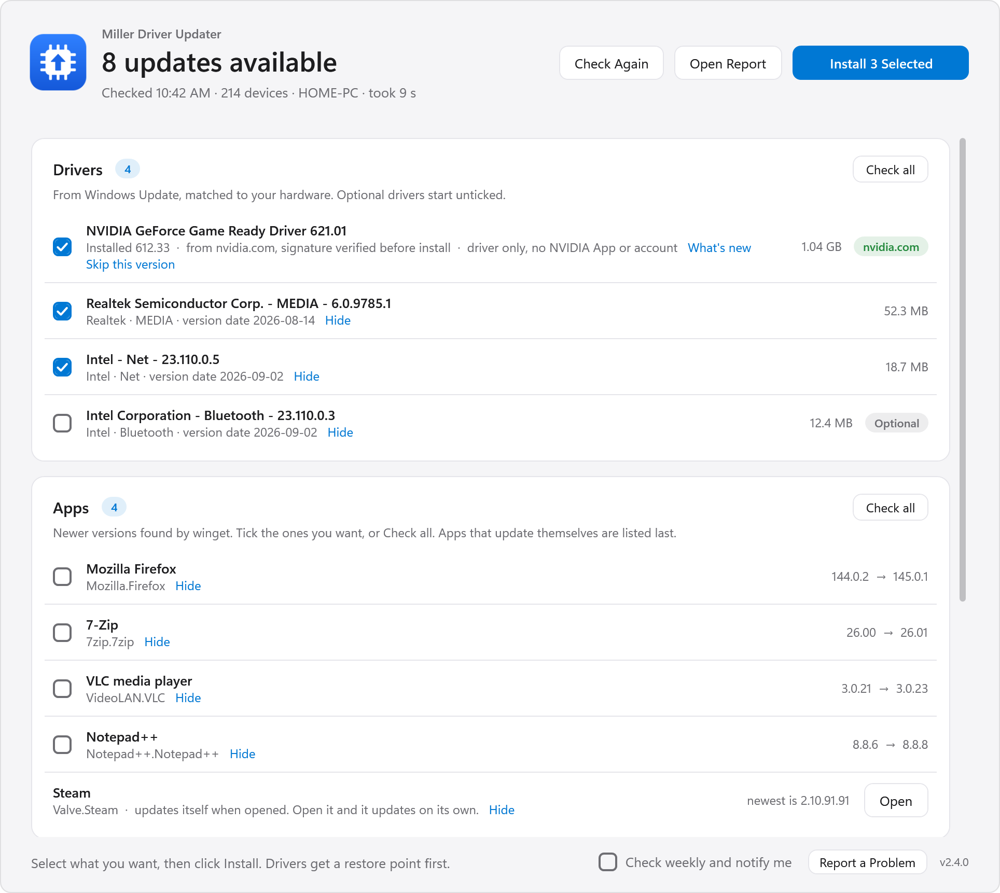

<p align="center">
  
</p>
<h1 align="center">Miller Driver Updater</h1>
<p align="center">
  Driver, NVIDIA and app updates for Windows, straight from Windows Update, nvidia.com and winget.<br>
  Free and open source. No ads, no bundled offers, no tracking.
</p>
<p align="center">
  <a href="https://github.com/mwmiller99-dot/MillerDriverUpdater/releases/latest"><b>Download for Windows 10 / 11</b></a>
  &nbsp;·&nbsp; <a href="#is-it-safe">Is it safe?</a>
  &nbsp;·&nbsp; <a href="#use-it">How it works</a>
</p>
<p align="center">
  <a href="https://github.com/mwmiller99-dot/MillerDriverUpdater/releases/latest"></a>
  <a href="https://github.com/mwmiller99-dot/MillerDriverUpdater/actions/workflows/build.yml"></a>
  <a href="LICENSE"></a>
</p>

<p align="center">
  <picture>
    <source media="(prefers-color-scheme: dark)" srcset="docs/screenshot-dark.png">
    
  </picture>
</p>

One check for everything on a Windows PC that can be updated from an official source: device drivers, the NVIDIA
graphics driver, and installed programs, plus a pointer to the right vendor app for mouse, keyboard and headset
firmware. You pick what to install; it makes a restore point and backs up each driver first, and it never restarts your
PC on its own.

| Source | What it covers |
|---|---|
| Windows Update driver catalog | Signed drivers for chipset, audio, network, USB, input, some firmware |
| winget (Microsoft's package manager) | Installed programs, and the vendor apps themselves |
| nvidia.com's own driver service | The newest GeForce driver, straight from NVIDIA and signature-checked; no NVIDIA App, no account |
| Vendor apps (AMD Adrenalin, Intel DSA, G HUB, Synapse, iCUE, SteelSeries GG...) | AMD/Intel GPU drivers and peripheral firmware, which only those apps can update |

## Install it

- **Setup (recommended):** download `MillerDriverUpdater-<version>-Setup.exe` from the
  [latest release](https://github.com/mwmiller99-dot/MillerDriverUpdater/releases/latest) and run it. It installs for
  your user account only (no administrator password), adds a Start menu entry, and can turn on a weekly check.
  Uninstall from Settings > Apps.
- **Portable:** `MillerDriverUpdater.exe` is the whole app (about 300 KB) and runs from anywhere.

When the app opens, Windows asks whether to let it make changes: installing drivers requires administrator rights.

## Is it safe?

- **Official sources only.** Drivers come from Windows Update, the NVIDIA driver from nvidia.com (its NVIDIA
  Corporation signature is checked before it runs), and programs through winget. There is no third-party driver
  database, no scraping, no repackaged installers.
- **Nothing changes until you click Install.** Checking is read-only. Before a driver changes, a restore point and a
  driver backup are made, and **Roll Back** puts the old driver back.
- **No ads, no bundled software, no telemetry.** The app itself talks only to Windows Update, nvidia.com and GitHub
  (to check for its own updates); app installers are fetched by winget from each publisher.
- **Open source and built in the open.** Every release is built and tested by
  [GitHub Actions](https://github.com/mwmiller99-dot/MillerDriverUpdater/actions) from this repository, with a signed
  build provenance attestation and SHA-256 checksums. To confirm a download is the official build:
  `gh attestation verify MillerDriverUpdater-<version>-Setup.exe --repo mwmiller99-dot/MillerDriverUpdater`.

**Why Windows or an antivirus may still warn.** Releases are not code-signed yet (see [SECURITY.md](SECURITY.md)).
Until they are, SmartScreen shows "Windows protected your PC" for the new download (*More info*
then *Run anyway*), and some antivirus programs quarantine new unsigned programs on a machine-learning guess, for
example Malwarebytes' "MachineLearning/Anomalous". Setup notices when that happens and pauses with **Retry / Cancel**:
allow the install folder in the antivirus, click Retry, and Setup carries on (Cancel leaves everything as it was).

## Use it

Open it. It checks on its own: devices, Windows Update, winget and nvidia.com are checked **at the same time**, so a
check takes about as long as Windows Update's search alone (around 10 s on a fast PC, up to a couple of minutes on a
slow one). The headline shows the percentage, paced by how long each step took on this PC last time.

- Drivers come ticked (optional ones unticked); apps are listed but unticked. **Click anywhere on a row** to tick it,
  or use **Check all / Uncheck all** on the card. **Enter** installs what is ticked, **F5** checks again.
- Click **Install N Selected**. Every row shows its own progress bar with size, speed and percent; the bar under the
  header (and the taskbar icon) shows the whole run. The window flashes in the taskbar when a check or install finishes.
- **Before you start** appears at the top when something is likely to get in the way, each with a fix button: no
  network, Windows Update service switched off, winget missing, System Protection off, a restart pending, on battery,
  low disk space, a metered connection. Nothing in it blocks you.
- **Needs attention** lists devices Windows reports a problem with. When an update on the same screen covers one, it
  says so; otherwise **Look Up Driver** searches the Microsoft Update Catalog for it.
- **Graphics and peripherals** names each device by the product name it reports ("Logitech G502 X", not "USB
  Composite Device") with an **Open App** button for its vendor app, or **Get App** (installs it through winget, or
  opens the vendor's page) when the app is missing.
- **Roll Back** appears on every driver this app replaced; earlier backups are listed in their own card.
- **Hide** (a small link on each update) keeps an update away for good, where the source itself remembers it: a driver
  is hidden in Windows Update (so Windows will not install it on its own either - use it after a Roll Back), an app is
  pinned in winget, and an NVIDIA version is skipped until a newer one comes out (**Skip this version**). **Hidden
  updates** lists them with **Unhide**.
- **History** lists what the app installed, rolled back or hid on this PC, newest first.
- **What's new** on the NVIDIA row opens nvidia.com's release notes for that driver.
- **Check weekly and notify me** (bottom) registers a silent Monday-morning check that shows a notification only when
  something is found; clicking the notification opens the app.
- **Report a Problem** (bottom right) saves the app's logs and latest report to a zip on the desktop and offers to open
  a new GitHub issue. The zip lists device names and driver versions, so share it privately, not on a public issue.
- The version number (bottom right) links here. The window follows your Windows light/dark setting and accent colour.

Errors come out in plain words ("Another installation is already running - wait for it to finish, then try again")
with the raw message after "Details:". Nothing restarts the PC on its own.

## It updates itself

When a newer version is published on this project's Releases page, a one-line banner appears at the bottom of the
window ("Miller Driver Updater 2.4.0 is available") with **What's New** and **Update**. The weekly check mentions it in
its notification too. Update:

1. downloads `MillerDriverUpdater-<version>-Setup.exe` from that release (github.com only),
2. checks it against the SHA-256 checksum GitHub lists for the file - and, once releases are code-signed, the
   publisher signature - and deletes it if anything is off,
3. closes the app and runs the Setup quietly; Setup keeps the current exe until the new one is known to run (an
   antivirus that removes the new one gets the old one put back), then opens the new version.

Nothing updates without that click, and never during an install. The repository is set in `Updater.Repo`
(app/Updater.cs); while it is empty, no check is made.

Publishing a version: bump it (Core.cs, app.manifest, installer/mdu.nsi), write `release-notes.md` and `CHANGELOG.md`,
commit, and run `release.cmd`. It checks the build here, then tags the version and pushes the tag; GitHub Actions
(`.github/workflows/release.yml`) builds and tests it on a clean Windows server, records a **build provenance
attestation** (GitHub's signed record that the files were built from this repository), and publishes the release.
`release.cmd local` builds and publishes from the PC instead. Every push is also built and tested (`build.yml`).

## What Install does, in order

1. Creates a system restore point (or notes the one Windows made today). If that fails it asks whether to continue.
2. Backs up the current driver of every device about to be updated (`pnputil /export-driver`).
3. Installs the Windows Update drivers - reusing the check's results, so there is no second 1-3 minute search.
4. Downloads the NVIDIA driver from nvidia.com, checks NVIDIA Corporation's signature, unpacks only the driver parts
   (7-Zip, installed through winget if missing) and runs NVIDIA's setup silently. Deletes the 1 GB package afterwards.
5. Upgrades the ticked programs through winget, one at a time, inside a hidden console so winget's live download counter
   shows. Each app is held to a watchdog: no output and no download growth for 6 minutes (4 if its installer opened a
   window and is waiting for a click) and its process tree is stopped, the row says why, and the run moves on.
   Apps that update themselves (Battle.net, Steam, Discord, browsers, Spotify...) are never run through winget; they
   get an **Open** button instead. "Version unknown" rows are left out of Check all and run last.
6. Shows a **Restart to finish** banner when needed. It never restarts for you.

## Command line

```
MillerDriverUpdater.exe                   the window
MillerDriverUpdater.exe --check           quiet check; a notification when something is found (what the weekly task runs)
MillerDriverUpdater.exe --schedule        register the weekly check (--unschedule removes it)
MillerDriverUpdater.exe --support-bundle  zip the logs onto the desktop
MillerDriverUpdater.exe --no-elevate      the window without the UAC prompt (checking works, installing does not)
MillerDriverUpdater.exe --ping            start and exit (Setup uses it to check an antivirus lets the exe run)
```

Reports, logs, scan timings and driver backups live in `%LOCALAPPDATA%\Miller Driver Updater\` (`reports\mdu-*.html`
opens in a browser; `reports\mdu.log` records how each step went).

## Build it

```
build.cmd
```

Compiles `dist\MillerDriverUpdater.exe` with the C# compiler that ships inside Windows (.NET Framework 4.8 - present on
every Windows 10 1903+ and Windows 11 PC), then runs the tests. No Visual Studio, no SDK, no downloads. The code is
C# 5 because that is what that compiler speaks. `build.cmd notest` skips the tests.

The Setup.exe needs NSIS 3 (`winget install --id NSIS.NSIS --exact`). After `build.cmd`:
`cd installer` then `"%ProgramFiles(x86)%\NSIS\makensis.exe" mdu.nsi` → `dist\MillerDriverUpdater-<version>-Setup.exe`
(it packs `dist\MillerDriverUpdater.exe`).

`tools\art.cmd` redraws the icon, installer pictures and GitHub preview image from `tools\ArtGen.cs`;
`tools\screenshot.cmd` redraws the screenshots above from the built app with made-up sample data.

## Layout

```
app/Program.cs          entry point: single instance, UAC relaunch, --check / --schedule / --support-bundle
app/MainWindow.cs       the window (WPF, built in code) + MainWindow.xaml (chrome and styles, embedded resource)
app/Scanner.cs          the parallel check and its honest percentage
app/InstallJob.cs       restore point -> backups -> Windows Update -> NVIDIA -> winget, with per-row progress
app/Inventory.cs        devices, problem devices, GPUs, peripherals (vendor maps live here)
app/WindowsUpdate.cs    WUA search/download/install with live progress
app/Winget.cs           winget table parser, upgrade with pseudo-console progress and watchdog
app/Nvidia.cs           nvidia.com lookup, download, signature check, driver-only install
app/Drivers.cs          restore point, pnputil backup/rollback
app/Preflight.cs        "Before you start" checks + plain-language errors
app/Report.cs           HTML/JSON report, support bundle, weekly task, notification
app/Choices.cs          skipped NVIDIA versions, History (reports\skipped.json, history.json)
app/Updater.cs          self-update: GitHub Releases check, download, SHA-256/signature check, Setup /UPDATE handoff
app/Native.cs           ConPTY, process trees, WinVerifyTrust, SetupAPI, window helpers, WUA callbacks
app/Core.cs             app identity, data folder, logging, formatting, process helper
app/app.manifest        asInvoker, Windows 10/11, per-monitor DPI
tests/Tests.cs          tests for the pure logic (run by build.cmd)
installer/mdu.nsi       NSIS script for MillerDriverUpdater-<version>-Setup.exe (+ wizard.bmp, header.bmp)
assets/                 app icon (.ico is compiled into the exe), logo.svg, PNGs
tools/                  ArtGen.cs (draws the artwork), ScreenshotGen.cs (README screenshots), art.cmd, screenshot.cmd
docs/                   README screenshots and the GitHub link preview (social-preview.png)
release.cmd             tag a version so GitHub Actions builds, attests and publishes it (release.cmd local: from this PC)
.github/workflows       build.yml (every push: build + tests), release.yml (version tags: build, attest, publish)
SECURITY.md, CHANGELOG.md, CONTRIBUTING.md, .github/ISSUE_TEMPLATE   security policy, changes, rules, issue forms
```

## Honest limits

- Peripheral firmware: the tool reads the version your mouse/keyboard/headset reports, but only the vendor's own app knows if a newer one exists. There is no public API for that, so the tool gets you to the app rather than guessing.
- AMD and Intel GPUs: neither publishes a driver-lookup service like NVIDIA's, so those still go through the vendor app.
- Bluetooth headphones/earbuds update through their phone app.
- BIOS/UEFI updates come from your motherboard or PC vendor's tool.
- Releases are not code-signed yet, so SmartScreen and some antivirus heuristics warn about them (see [Is it safe?](#is-it-safe)).

## License

MIT - see [LICENSE](LICENSE). Until 2.1 the app was called *Miller Driver Update*; installing a newer version replaces
it and keeps its reports, driver backups and weekly check.
